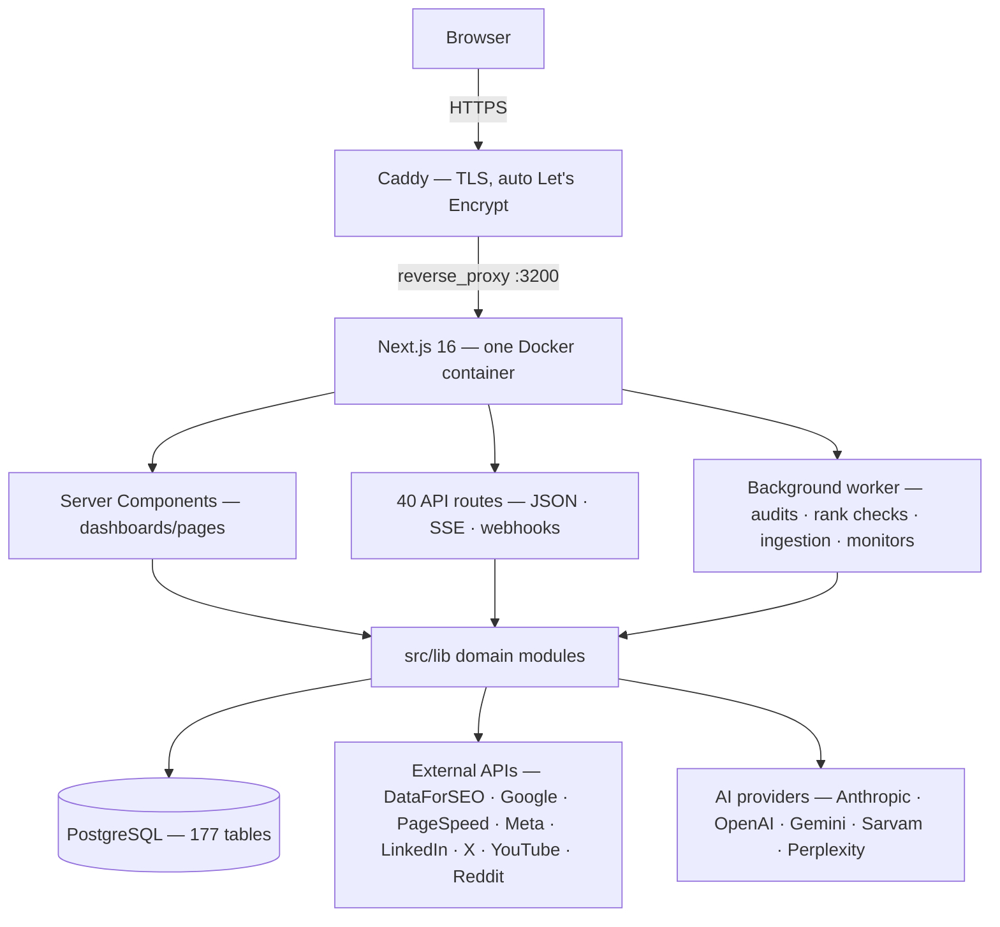
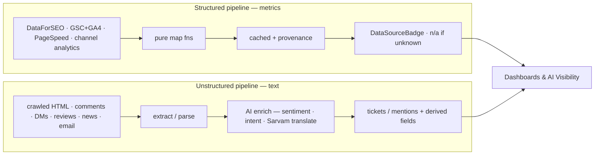
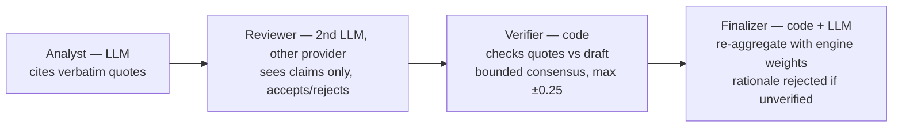

# NerveSEO (SynapseSEO + CX)

**A two-in-one, production-grade platform custom-built for Parul University:** a Semrush-class SEO
suite that lifts the brand's visibility in Google and in AI answer engines, welded to a Konnect-class
CX workspace that pulls every public comment, review and DM from Facebook, Instagram, WhatsApp, X,
LinkedIn, YouTube and more into a single inbox to triage and reply from.

One AI key drives both halves, one database stores both halves, one security model guards both.

---

## At a glance

| Dimension | Value |
|---|---|
| Codebase | ~138,000 lines of TypeScript, 960 files |
| HTTP API routes | 40 |
| Database tables | 177 (single Postgres schema) |
| SEO tools | ~40 (Keyword Magic, Backlinks, Site Audit, Position Tracking, AI Visibility, live crawler) |
| CX channels | 23 (email, chat, web form, FB, IG, WhatsApp, X, LinkedIn, YouTube, Reddit, Bluesky, Mastodon, Discord, Telegram, Discourse, GBP, reviews, calls) |
| AI providers | 5, with automatic failover (Anthropic → OpenAI → Gemini → Sarvam; Perplexity for AI Visibility) |
| Multi-agent pipeline | 4 roles (Analyst → Reviewer → Verifier → Finalizer) over 13 score-card outputs |
| Runtime | Next.js 16 / React 19 / Node — one Docker container + Caddy on one GCE VM |

---

## What it is, and who it is for

The platform answers two questions a university brand lives or dies by, and joins them into one workflow:

1. **"When someone searches for us — or asks ChatGPT, Gemini or Google's AI Overview about us — what do they find?"**
   That is the **SEO half**: rank tracking, keyword and content strategy, technical audits, backlink
   analysis, and a dedicated AI-visibility tracker for the answer engines that now sit between the
   university and its applicants.
2. **"When someone talks about us or to us online, can we see it and respond — fast, in one place, in the right language?"**
   That is the **CX half**: a unified inbox and social-listening workspace that ingests comments, DMs,
   mentions, reviews and tickets across 23 channels, scores sentiment and intent, and lets one team
   answer all of them without logging into ten different apps.

**Custom-for-Parul decisions** are threaded throughout: Indian-language handling (Sarvam AI translates
Hindi, Gujarati, Bengali, Tamil, Telugu and romanized Hindi before sentiment scoring), an India-first
data engine, admissions- and placement-aware content-intent detection, and an ORM (online-reputation-
management) posture aimed at the narratives a large Indian university must manage in search and AI.

---

## System architecture

Every request takes the same path, and everything runs inside one container on one VM.



Cross-cutting services wrap every layer: session auth, the AES-GCM secret store, per-user rate limits,
the monthly API budget cap, and the SSRF-safe fetcher. A feature is a page, a route, a `lib` module and
a set of tables — nothing is hidden behind a network boundary, so one engineer can reason about the
whole system.

---

## Technology stack, and why each choice

| Layer | Choice (version) | Why this was chosen |
|---|---|---|
| App framework | Next.js 16 App Router | One process serves server-rendered pages, the 40 API routes, and the background worker — no separate backend to run, deploy or secure. |
| UI | React 19 + Tailwind 4 + Recharts + lucide | Server Components keep data fetching on the server; Recharts renders the dashboards; Tailwind gives one design system. |
| Language | TypeScript | One type system spanning DB rows, API payloads and UI props; mistakes caught at compile time. |
| Database | PostgreSQL — PGlite (embedded) or `pg` (external) | Full Postgres semantics with zero ops; embedded single-file DB for one VM, swappable to managed Postgres via `DATABASE_URL` with no code change. |
| AI | Anthropic SDK + `fetch` for OpenAI / Gemini / Sarvam | One abstraction over five providers with automatic failover. |
| Crawl / parse | cheerio, robots-parser, tldts, ipaddr.js, fast-xml-parser | HTML and sitemap parsing, robots compliance, registrable-domain math, SSRF IP validation. |
| Inbox transport | imapflow, nodemailer, mailparser | Real mailbox ingestion and sending for the CX email channel over IMAP/SMTP. |
| Validation | zod | Every AI output and API input validated against a schema at the edge. |

**Why a modular monolith and not microservices.** For one VM serving one university, a single Next.js
app is cheaper to run, simpler to secure (one origin, one secret store, one session system), and far
faster to ship. Separation lives in the module boundaries under `src/lib/*` — `seo`, `cx`,
`ai-visibility`, `optimizer`, `crawler`, `integrations` — without the operational tax of a distributed
system.

---

## The data layer: one database, 177 tables

`src/lib/db.ts` applies the full schema at boot inside a `pg_advisory_xact_lock` (so two concurrent
boots cannot race the migration), then hands the app a tiny `query` / `transaction` interface. It uses
either **PGlite embedded** (default — real Postgres in-process, persisted to `.data/postgres`) or
**external Postgres** via `pg` by setting `DATABASE_URL` — same code, no rewrite.

**Why embedded Postgres.** A single-tenant deployment doesn't need a database cluster. PGlite gives full
SQL, transactions and advisory locks with no ops burden — which is why deploys stop the container
gracefully (so the DB flushes to disk) and never hard-reset the VM (a power-cut can corrupt the file).

The schema is authored as 23 domain files under `src/lib/schema/` and assembled into one string, so the
data model reads like the feature list (`users`, `sessions`, `projects`, `ai_prompts`, `audit_pages`,
`bl_*`, `bm_mentions`, `cx_tickets`, `cx_messages`, `cx_admin_*`, …).

---

## Structured vs unstructured data pipelines



- **Structured** sources are already tabular; rows are mapped by pure, unit-tested functions, cached
  with provenance, and every figure carries a source badge. Unknown values render `n/a` — never `0`,
  never an estimate (`docs/REAL-DATA.md`, enforced by `data-mode.ts`). A brand cannot present guessed
  numbers to its leadership.
- **Unstructured** sources are free text; they are extracted/parsed, AI-enriched (sentiment, intent,
  language detection, Sarvam translation for Indic languages), and stored with **derived structured
  fields** the structured side can aggregate.

---

## The AI layer: five providers, one interface

All AI in both products flows through one server-only module, `src/lib/providers/llm.ts`. Whichever key
is configured is used, in priority order `ANTHROPIC_API_KEY → OPENAI_API_KEY → GEMINI_API_KEY →
SARVAM_API_KEY`; when a provider fails, the next configured one is tried automatically. Claude runs
through the official SDK; OpenAI, Gemini and Sarvam run over `fetch` — all four validate output against
the **same zod schema**, so callers get an identically-typed result no matter which model answered.

| Provider | Default model | Role | Why chosen |
|---|---|---|---|
| Anthropic (Claude) | `claude-opus-5-5` | Primary writer + reviewer; AI Visibility | Strongest reasoning + structured-output reliability |
| OpenAI | `gpt-6-astra` | Failover; CX image generation (`gpt-image-1`) | Only provider wired for images |
| Google Gemini | `gemini-3.8-flash` | Failover; AI Visibility | Fast, cheap failover; tracks Gemini's answer surface |
| Sarvam AI | `sarvam-105b` | Indic translation, sentiment, inbox translation | Purpose-built for Indian languages — the custom-for-Parul choice |
| Perplexity | preset `low` | AI Visibility only | Tracks Perplexity's answer engine |

**Why multi-provider:** (1) resilience — one outage never takes the product down; (2) independence — the
multi-agent reviewer is pinned to a *different* provider for a genuine second opinion; (3) fit — Sarvam
for Indic, OpenAI for images, each engine tracked in AI Visibility; (4) cost — every paid call reserves
its worst-case cost against the monthly budget first.

---

## The 4-agent verified scoring pipeline (evaluation & debugging framework)

The platform's answer to hallucination. When the Pre-Publish Optimizer scores a draft across 58 on-page
checks and 13 score-card outputs, it never trusts one model. For each output it runs
(`src/lib/optimizer/agents/`):



| Property | How | Why it matters |
|---|---|---|
| No fabrication reaches the user | `checkQuotes`, `hasFabricated`, `guardRationale` reject any claim whose quote is absent and any rationale that invents a figure | No AI advice built on made-up evidence |
| Independent cross-examination | Reviewer pinned to a different provider (`providersFor(n)`) | Catches a single model's systematic error |
| Deterministic, testable core | Quote verification, consensus, confidence and score application are pure functions (`verify.ts`) | Reproducible, debuggable with unit tests |
| Stage-level observability | Each output records a ledger of analyst/reviewer/verifier/finalizer stages | A failure is located, not guessed |
| Confidence is measured | A run with >20% failed stages is downgraded to "partly verified / low confidence" | The product tells you how much to trust each result |
| Bounded authority | `MAX_ADJUST = 0.25` caps how far AI moves the engine's deterministic score | Scoring stays anchored to code |

---

## The SEO subsystem

A ~40-tool suite, each a page under `src/app/(app)/` backed by a `lib` module.

| Family | Tools | Data source |
|---|---|---|
| Keyword intelligence | Keyword Magic, Overview, Strategy, Gap, PPC, Topic Research | DataForSEO + Autocomplete |
| Competitive & market | Domain Overview, Organic/Advertising Research, Market Explorer, Traffic Analytics, Bulk Analysis | DataForSEO |
| Rank & SERP | Position Tracking, SERP Sensor, Map Rank Tracker | DataForSEO + Search Console |
| Backlinks | Backlink Analytics, Audit, Gap, Link Building | DataForSEO |
| Technical & content | Site Audit, On-Page Checker, Pre-Publish Optimizer, Log File Analyzer, Writing Assistant | Live crawler + PageSpeed + AI |
| Local | Google listings, reviews, Map Rank | DataForSEO Business Data |
| AI Visibility | brand presence in ChatGPT, Gemini, Perplexity, AI Overviews | AI providers + DataForSEO |
| Organic Traffic Insights | combined first-party traffic | Search Console + GA4 |

### The live crawler (the "spider")

Paste a URL at `/optimizer/crawler`; the server opens a **Server-Sent Events** stream and a polite
spider walks the site live, emitting events (`start → fetching → page → touch → flag → score →
summary`) the UI renders as the spider moving through each page. Properties
(`src/lib/optimizer/crawl/run.ts`):

- **Polite by construction** — robots.txt obeyed, `Crawl-delay` honoured (capped 20s), one request per
  host at a time, same registrable domain only, depth ≤ 3, page + total-time caps.
- **SSRF-safe** — every fetch goes through `src/lib/crawler.ts`: public unicast IPs only, IP pinned at
  connect (anti DNS-rebinding), credentials/odd ports blocked, size/time limits, every redirect
  re-validated.
- **Per-page audit** — extracts title/meta/headings/links/images, runs 58 on-page checks, scores each
  page.
- **Automatic broken-link detection** — HEAD/GET-checks up to 15 of each page's *outbound* links. (This
  is link validation, not backlink analysis — a dead outbound link is an SEO/UX defect.)

---

## The CX subsystem

A Konnect-class workspace: every public comment, DM, mention, review and message across 23 channels
lands in **one inbox**, scored and routed, to be answered by one team. Four modules under
`src/lib/cx/`:

| Module | What it does | Channels |
|---|---|---|
| **Inbox** | Unified ticketing; public comments thread per conversation | Email, chat, web form, FB, IG, WhatsApp, X, LinkedIn, Discord, Telegram, Discourse |
| **Listening** | Mentions, language detection (Sarvam Indic→EN), sentiment & intent, spikes, crisis | YouTube, Reddit, Bluesky, Mastodon, HN, App Store, News, Google reviews |
| **Publishing** | Schedule + post; AI compose + image generation | FB, IG, Threads, X, LinkedIn, YouTube, GBP |
| **Insights** | Dashboards, SLA, quality AI pre-scoring, crisis summaries, reports, CSAT/NPS | all |

### How replies work

The reply engine (`src/lib/cx/inbox/dispatch.ts`) is **channel-aware**: one "Reply" box routes to the
right API per channel — SMTP for email, Cloud API for WhatsApp, Meta Graph for FB/IG (DMs via
`me/messages`, comments via `{comment}/comments`/`/replies`, respecting Meta's 24-hour DM window),
Community Management API for LinkedIn, bot APIs for Discord/Telegram/Discourse. A reply that can't be
sent is **stored and clearly marked, never silently dropped**. So one agent answers every channel from
one screen.

### Meta integration

Meta is the deepest integration (listening, inbox, publishing, analytics). It connects via a Meta app
with a webhook at `/api/cx/webhooks/meta` and a long-lived Page token stored **encrypted**. The `GET`
handshake is guarded by `META_VERIFY_TOKEN`; every `POST` event is authenticated by an
`x-hub-signature-256` HMAC verified with `META_APP_SECRET`; saving a channel auto-subscribes the Page.

---

## Security model

| Control | Implementation | Why |
|---|---|---|
| Secrets at rest | AES-256-GCM (`secrets.ts`); key = SHA-256(`APP_SECRET`) | Every stored token encrypted; tampering fails the GCM auth tag |
| VM-local master key | `APP_SECRET` generated on the VM, never in repo/metadata | Key never leaves the machine |
| Password hashing | scrypt + per-user salt, `timingSafeEqual` | Constant-time, no plaintext |
| Sessions | httpOnly + secure + sameSite cookie; only the token hash stored | A stolen DB reveals no usable token |
| Rate limiting | DB-backed per-key limiter (e.g. 30 crawls/hour/user) | Abuse and runaway loops throttled |
| SSRF defence | public unicast IPs only, IP pinned at connect, redirects re-validated | A crawl cannot reach GCP metadata/internal services |
| Webhook authenticity | `x-hub-signature-256` HMAC + verify-token handshake | Only Meta can deliver events |
| API budget caps | `GLOBAL_API_BUDGET_USD` + per-user cap; worst-case cost reserved first | No unbounded DataForSEO/AI bill |

---

## Deployment & access model

One Docker container + a Caddy reverse proxy on a single Google Compute Engine VM. Deployment is a
`startup-script` stored as instance metadata (`deploy/gce-startup.sh`) that runs on every boot: installs
Docker/git, pulls `main`, reads config from instance metadata, generates `APP_SECRET` if absent, builds
the image, **gracefully** replaces the running container (so the embedded DB flushes), and health-checks
`/api/health`. Caddy auto-provisions a Let's Encrypt cert.

**No direct SSH.** Administration is done without a shell — configuration via
`gcloud compute instances add-metadata` (applied on next boot, or immediately via
`sudo google_metadata_script_runner startup`), logs via `get-serial-port-output`. This is a posture, not
a limitation: no standing SSH surface, all config is declarative metadata, the app rebuilds from Git on
every boot. A deploy is: push `main`, then `gcloud` **stop + start** (never `reset` — a hard power-off
can corrupt the embedded DB).

---

## Repository layout

```
src/
  app/
    (app)/        ~40 SEO tool pages + /cx CX workspace
    api/          40 route handlers (JSON · SSE · webhooks)
  components/     UI (charts, shell, per-tool components)
  lib/
    db.ts         DB connection + schema boot (PGlite | Postgres)
    auth.ts       sessions, scrypt passwords, rate limiting
    secrets.ts    AES-256-GCM secret store
    crawler.ts    SSRF-safe fetcher
    providers/    unified AI layer (llm.ts) + Sarvam/Anthropic adapters
    optimizer/    Pre-Publish Optimizer
      agents/     the 4-agent verified scoring pipeline
      crawl/      the live SSE spider
    ai-visibility/ AI answer-engine tracking
    seo/engine/   deterministic India-first data engine
    backlinks, keywords, competitive, position-tracking, sensor, local, monitoring
    google/       GSC + GA4 integration
    integrations/ registry.ts — catalogue of every API/key and what it powers
    cx/
      inbox/      ticketing + channel-aware dispatch + webhooks
      listening/  social listening + crisis + Indic
      publishing/ scheduling + adapters + AI compose
      insights/   dashboards, SLA, quality, surveys, reports
    jobs/         background worker queue
    schema/       23 domain files → 177 tables
deploy/
  gce-startup.sh  the entire SSH-less, boot-time deploy
docs/
  BUILD-BRIEF.md · REAL-DATA.md · CX-BRIEF.md
```

---

## Getting started (development)

```bash
npm install
cp .env.example .env.local   # fill in keys (all optional; demo mode works without them)
npm run dev                  # http://127.0.0.1:3200
```

With no API keys, every metric that needs a web-scale index shows a `NeedsData` card (or labelled demo
data in local dev) — the platform never invents numbers. Add keys in `.env.local` to light up live data;
**Settings → Integrations** shows which key powers which feature.

- `npm run typecheck` — TypeScript, must be clean
- `npm test` — unit tests (`tsx --test`)
- `npm run test:e2e` — Playwright

---

## License

Private and proprietary. Custom-built for Parul University. All rights reserved.
